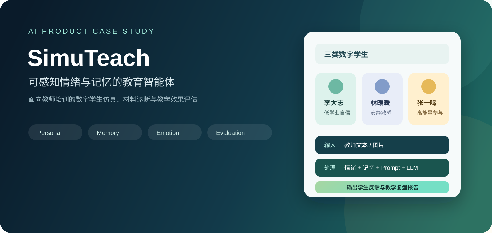
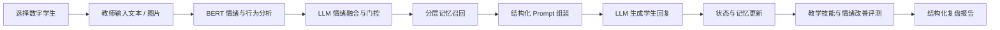
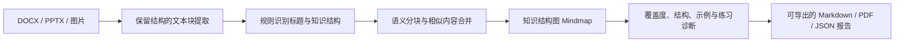

  

  <strong>AI 产品案例</strong> ·
  <strong>团队作品</strong> ·
  <strong>可运行原型</strong> ·
  <strong>教育智能体</strong>

  <a href="#项目背景">项目背景</a> ·
  <a href="#产品方案">产品方案</a> ·
  <a href="#ai-能力与边界">AI 能力与边界</a> ·
  <a href="#评测与-badcase">评测与 Badcase</a> ·
  <a href="#我的工作">我的工作</a>

  <a href="https://josieiswjx.github.io/simuteach-ai-product-case/"><strong>打开交互式产品演示 →</strong></a>

# SimuTeach：可感知情绪与记忆的教育智能体

面向教师培训的数字学生仿真产品。教师可以在低风险环境中练习课堂互动；系统通过人格、情绪状态和分层记忆生成差异化学生反馈，并把课堂过程转化为可解释的教学技能评测报告。

> **项目定位：**团队课程与竞赛项目，已具备可运行原型和基础工程闭环，尚非生产级系统。本页用于呈现产品设计与验证思路，不表示所有代码均由本人独立完成。

## 项目背景

师范生在真实课堂中获得高频、个性化练习的机会有限。普通聊天机器人通常存在三个问题：

- 不同学生角色回答高度同质，无法模拟真实的课堂差异。
- 缺少持续情绪和记忆，前后多轮对话容易失真。
- 只有对话、没有评价，教师难以判断一次练习哪里做得好。

SimuTeach 把产品拆成两个连续场景：

1. **课堂模拟：**选择数字学生，进行多轮教学互动。
2. **课后复盘：**分析教师的教学行为、材料结构与学生的情绪变化。

## 用户与核心任务

| 用户 | 需求 | 产品回应 |
|---|---|---|
| 师范生 / 教师培训学员 | 在低风险环境中反复练习课堂互动 | 多轮课堂对话、不同学生人设、可复盘记录 |
| 指导教师 | 看到可解释、可比较的练习结果 | 教学技能评分、情绪改善指标、内容摘要 |
| 教研与内容人员 | 快速检查教学材料的覆盖度和结构 | DOCX/PPTX/图片解析、知识结构图、材料诊断 |
| 产品与研发团队 | 管理多个角色并稳定运行 | 配置驱动的 Persona、统一 API、共享基础设施 |

## 产品方案

### 核心闭环

### 差异化人设

三个数字学生覆盖不同的参与模式，使教师面对的不是同一个“换皮机器人”：

| 人设 | 行为特征 | 教学设计意图 |
|---|---|---|
| 李大志 | 学业自信较低、容易紧张、回答可能犹豫 | 训练教师进行鼓励、拆解问题和降低表达压力 |
| 林暖暖 | 安静敏感、需要安全感的互动环境 | 训练教师观察非显性反馈并耐心追问 |
| 张一鸣 | 高能量、参与积极、容易争取注意 | 训练教师进行课堂节奏和注意力管理 |

角色通过 JSON 配置驱动，包括 Big Five 数值、行为描述、情绪基线、参与模式和 Prompt 信息。长期人格档案和运行时情绪状态相互分离，避免编辑初始设定时覆盖当前课堂状态。

### 教学材料分析

该模块体现的是一套“把非结构化资料转成可分析字段”的方法，而不是简单把整份文档直接塞给大模型。

## AI 能力与边界

### 1. Agent 架构

- 每个 Persona 独立维护记忆、情绪状态和注意力状态。
- 多个 Persona 共享 BERT、LLM、并发控制与融合引擎，降低重复资源消耗。
- 通过统一的 Persona Registry 和路由机制选择当前数字学生。

### 2. Prompt 工程

Prompt 被拆成四类信息：

- 静态人格：身份、Big Five、行为风格和语言方式。
- 半静态记忆：跨会话事实、用户画像和历史上下文。
- 动态情绪：当前 V-A 情绪状态与行为提示。
- 当前输入：教师消息与多模态内容描述。

这种分层避免了把所有信息混成一段长 Prompt，也便于缓存和问题定位。

### 3. API、JSON 与多模态

- 提供 OpenAI 兼容的 `POST /v1/chat/completions`。
- 提供服务发现和健康检查接口。
- 请求、角色配置、诊断报告和评测结果均使用结构化 JSON。
- 支持文本与图片输入；图片先由视觉模型转成文字描述，再交给主对话模型。

### 4. 知识检索与文档理解

项目已经具备与 RAG 相近的基础能力：

- 文档结构抽取。
- 文本语义分块。
- 相似内容缓存与标题归属。
- 知识覆盖度判断。

当前定位是**文档分析与知识结构化原型**，并非完整的生产级 RAG 问答系统。案例页不会把局部能力夸大为端到端 RAG 产品。

### 5. 能力边界控制

- BERT 情绪结果经过历史可靠度和置信度门控，低置信结果不会直接改变 Prompt。
- LLM 分类超时或失败时，系统可以回退到小模型结果。
- 文档格式、大小和可解析内容均有明确限制。
- 上传材料在单次分析完成后清理，不默认长期保存。
- 当前版本仍需完善限流、鉴权、观测性、分布式资源管理和完整端到端测试。

## 评测与 Badcase

### 已实现的评测框架

系统从对话日志生成结构化报告，包含：

- **22 项教学技能指标：**讲解清晰度、课堂管理、心理沟通。
- **BCEI 情绪改善指标：**扣除情绪状态机自然回归后的教师干预贡献。
- **教学内容摘要：**知识点列表与课堂主线摘要。
- **材料诊断：**知识覆盖、结构、亮点、缺失点和改进建议。

评测结果通过 OpenAI 响应的扩展字段返回，不破坏原有接口兼容性。项目文档中包含一次 107 轮课堂对话的完整评测输出示例。

### Badcase 验收设计

| 场景 | 预期风险 | 判断方式 | 处理方向 |
|---|---|---|---|
| 三个人设回答趋同 | 人格失去区分度 | 同一问题下的风格一致性评分 | 检查人格 Prompt、配置权重和模型路由 |
| 情绪判断错误 | 错误情绪被注入回复 | 低置信样本人工复核 | 置信度门控、LLM 融合、失败回退 |
| 跨会话记忆串线 | 不同学生共享上下文 | 多用户隔离测试 | 使用 Persona / user ID 隔离记忆 |
| 文档内容未覆盖却给出结论 | 模型幻觉 | 检查结论是否有原文证据 | 无证据不输出，保留缺失点 |
| 大模型超时 | 对话中断或延迟过高 | 超时、失败率与降级路径 | 小模型回退、重试和并发控制 |
| 不支持的文件或过大文件 | 解析失败、资源占用 | 上传边界测试 | 上传前校验并返回明确错误 |

> 上表是产品验收设计，不等同于所有场景都已完成自动化回归。案例页明确区分“已实现”和“待验证”。

## 关键产品决策

| 决策 | 原因 | 代价 |
|---|---|---|
| 用人设配置代替每次手写 Prompt | 便于管理三个角色，保持行为稳定 | 非技术用户仍需要可视化编辑界面 |
| 采用 BERT + LLM 双信号 | 同时兼顾响应速度和情绪判断质量 | 链路复杂度和调用成本增加 |
| 分层记忆而非无限拼接历史 | 控制上下文长度并保留长期关系 | 需要摘要、召回和隔离策略 |
| 多 Persona 共享基础设施 | 降低模型重复加载与资源消耗 | 需要更严格的资源释放和故障隔离 |
| 文档单次分析后清理 | 降低隐私和存储风险 | 不支持跨文件长期知识库 |

## 实现与验证证据

- 三个数字学生角色及配置驱动的人设模型。
- 多轮对话、人设路由、分层记忆和动态情绪状态。
- OpenAI 兼容 API、流式输出、图片输入和结构化错误响应。
- DOCX、PPTX、JPG、JPEG、PNG 教学材料分析。
- 知识结构图、材料诊断和结构化报告。
- 22 项教学技能指标与 BCEI 情绪改善指标。
- 单元测试、CI、Docker 部署和多人格资源清理。

**说明：**原项目为团队私有仓库，源码、模型密钥和真实课堂数据不对外公开。本页只展示产品设计、公开接口说明与验证思路；面试时可根据项目权限安排演示。

## 我的工作

作为团队核心成员，参与产品从需求定义、方案设计到联调验收的全流程：

- 梳理教师培训场景、用户任务和产品边界。
- 参与三类数字学生的人设建模、行为定义与配置结构设计。
- 参与课堂交互、Prompt、记忆、材料分析与教学评测方案的规划。
- 设计异常、Badcase 和验收场景，并推动跨模块联调。
- 参与产品演示、文档整理和最终交付。

> 这是团队协作成果。页面强调产品闭环和本人参与的工作，不把团队代码全部归为个人贡献。

## 复盘与下一步

当前最有价值的下一步不是继续增加技术名词，而是完成真实用户验证：

1. 邀请 5-8 名师范生完成同一教学任务，比较不同人设带来的练习差异。
2. 建立 30-50 条 Badcase 测试集，量化人格一致性、任务完成率和情绪识别准确率。
3. 为教研人员提供可视化 Persona 编辑器和材料分析结果反馈机制。
4. 补充运行时监控、权限控制和失败恢复，验证多人课堂场景的稳定性。

---

**作者：**韦洁迅  
**项目类型：**软件工程课程 / 教育智能体团队项目  
**状态：**可运行原型，持续迭代中

